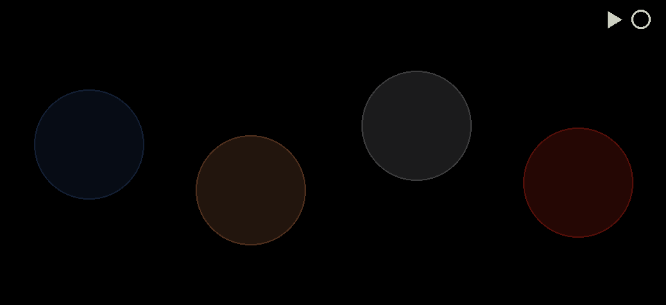

# slow-p1 field packs

Five packs for the **OP-1 Field** running Faust's [open-field](https://github.com/LaP0573/open-field) custom firmware.

<table>
<tr>
<td align="center"><a href="felt/"></a><br><a href="felt/"><b>felt</b></a></td>
<td align="center"><a href="roads/"></a><br><a href="roads/"><b>roads</b></a></td>
</tr>
<tr>
<td align="center"><a href="bows/"></a><br><a href="bows/"><b>bows</b></a></td>
<td align="center"><a href="fourloop/"></a><br><a href="fourloop/"><b>4loop</b></a></td>
</tr>
<tr>
<td align="center"><a href="pendulum/"></a><br><a href="pendulum/"><b>pendulum</b></a></td>
<td></td>
</tr>
</table>

| # | Pack | Kind | Files you need |
| --- | --- | --- | --- |
| 1 | [felt](felt/) | synth engine: soft felt piano | `felt.pack` + `felt.msb` |
| 2 | [roads](roads/) | synth engine: electric piano | `roads.pack` + `roads.msb` |
| 3 | [bows](bows/) | synth engine: string section | `bows.pack` + `bows.msb` |
| 4 | [4loop](fourloop/) | master effect: four loopers | `4loop.pack` |
| 5 | [pendulum](pendulum/) | sequencer: swinging notes | `pendulum.pack` |

Download the files from **[Releases](../../releases)**.

## Needs

- OP-1 Field with **open-field installed**, base 30 or newer (see Faust's repo for install).
- Tested on OS 1.7.3.

## Install

1. Turn the Field on normally, then **shift + COM**, then **shift + T4** for disk mode.
2. Copy the `.pack` files into the `packs` folder.
3. For felt, roads and bows: copy the `.msb` into the pack's own folder (`felt`, `roads`, `bows`). The folder appears after the first start with the pack; make it if it is not there.
4. Eject, power off, power on.
5. **Updating** an engine: also delete `synth_presets/<name>` (for example `synth_presets/felt`) so the new sounds load.

No reflash is needed to add or remove packs. Hold **HELP** at power-on to start without packs.

## Where they show up

- Engines (felt, roads, bows): on a synth sound, **shift + T1**, pick from the engine list.
- 4loop: in the mixer's **master effect** list.
- pendulum: at the end of the **sequencer** list.

## Building from source

The packs build with the open-field tools and its Blackfin toolchain (macOS). Copy a pack folder into your open-field checkout (for example `open-field/felt/`) and run:

```
python3 -I tools/pack_build.py build3 --recipe felt/recipe.json --profile profiles/op1f-1.7.3.json --out out/felt.pack
```

## License

Code: GPL-3.0-or-later with an OP-1 firmware permission (LICENSE, NOTICE). Samples: see each pack's `bank/` folder. **roads.msb is CC BY-NC 4.0: share it with credit, don't sell it.** No Teenage Engineering firmware is in this repo.

Not affiliated with Teenage Engineering. Use at your own risk.
