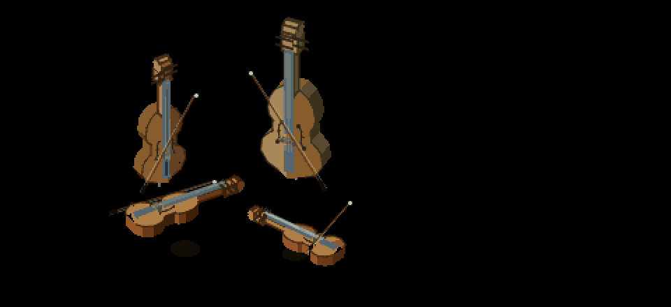

# bows

A string section: contrabass, cellos, violas and violins from real recordings, with a string machine layer and a grain stretch. An open-field **synth engine**. 6 voices, stereo.

## Install

`bows.pack` into `packs`, `bows.msb` into the `bows` folder. After an update, delete `synth_presets/bows`. Pick it with **shift + T1** on a synth sound. Two sounds come with it: `bows` and `bows ambient`. The bank is big (about 3 MB); if the base has no room, the page says so.

## Knobs

| Knob | Turn | Shift + turn |
| --- | --- | --- |
| blue | bow (attack, up to a 4 s swell) | release |
| ochre | ensemble (string machine layer) | warmth |
| grey | stretch (grains, up to 1/64 speed) | vibrato |
| red | ambient | width |

**Red press** = velocity on/off (saved in `bows.cfg`). On: soft or loud recording by velocity. Off: always loud.

## Files

`bows.cpp` engine and page, `bows_scene*.h` page, `core/` sample core, `recipe.json`, `tools/vsco_to_msb.py` bank builder, `tests/`, `bank/` sample credits.

Samples: VSCO 2 Community Edition by Versilian Studios (Sam Gossner), CC0. Code: GPL-3.0-or-later.
