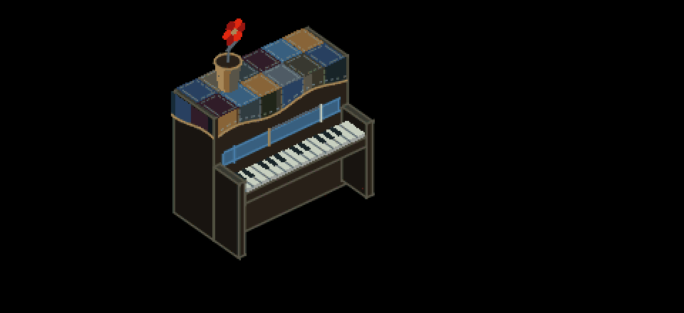

# felt

A soft felt piano, as an open-field **synth engine**. 6 voices, stereo.

_Simulated on a computer from the pack's own scene code (values and names hidden): the room wakes as you play, then the style knob swaps vase, tape and book._

## Install

`felt.pack` into `packs`, `felt.msb` into the `felt` folder. After an update, delete `synth_presets/felt`. Pick it with **shift + T1** on a synth sound. Two sounds come with it: `felt` and `felt wash`.

## Knobs

| Knob | Turn | Shift + turn |
| --- | --- | --- |
| blue | felt (tone) | start |
| ochre | decay | loop in |
| grey | style: brown, blue, grey piano | loop out |
| red | ambient (stereo wash) | width |

**Red press** = velocity on/off (saved in `felt.cfg`). On: soft and firm recordings by how hard you play. Off: one level, soft recordings only.

## Files

`felt.cpp` engine and page, `felt_scene.h` 3D page, `core/` the FELT sample core, `recipe.json` build recipe, `tools/felt_to_msb_vel.py` bank builder, `tests/` host tests, `bank/` sample credits.

Samples: Osiris Piano (Versilian Studios, Karoryfer Samples), CC0. Code: GPL-3.0-or-later.
