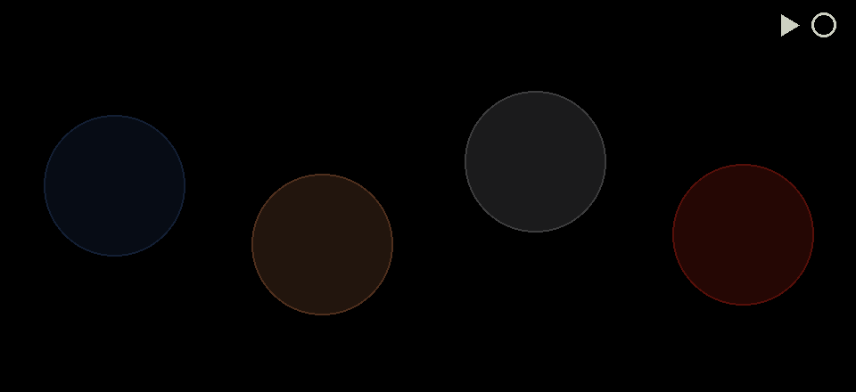

# 4loop

Four stereo loopers on the master, as an open-field **master effect**.

_Simulated on a computer from the pack's own core and page code (text hidden, quiet stretches sped up): four takes recorded, levels, octaves, reverse, an overdub, loop size, sync, pause, and a loop cleared and recorded again._

## Install

`4loop.pack` into `packs`. Pick `4loop` in the mixer's master effect list. Master only: on a synth or drum sound it passes the sound through. The page: T3 on the mixer, or shift + metronome anywhere.

## Keys (page shown)

| Control | Does |
| --- | --- |
| knob turn | loop level (1 knob per loop) |
| shift + turn | speed (octaves) |
| T1 held + turn | pan |
| knob press | record / finish / overdub |
| shift + knob press | reverse |
| hold knob 1 s | clear that loop |
| T4 or shift + T1 | sync on/off |
| T3 | pause / play |
| shift + T3 | the unit's master effect list |
| help (held) | loop details |

The first take waits for sound before it starts.

## Files

`src/fourloop.cpp` effect and page, `src/core/` the 4loop core, `src/fourloop_fw.h` the only firmware addresses used (OS 1.7.3), `recipe.json`, `tools/make_svg.py`, `tests/`.

Code: GPL-3.0-or-later. Build: copy this folder into open-field as `fourloop/`.
