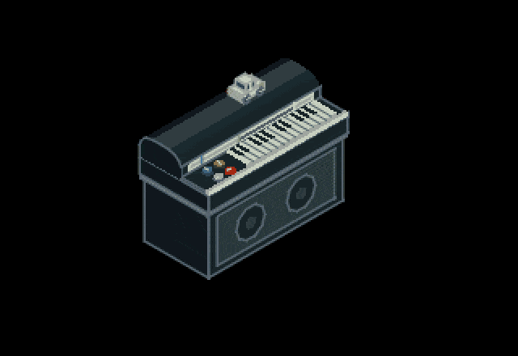

# roads

An electric piano ("Roads", like Rhodes), as an open-field **synth engine**. 6 voices, stereo. The page grows a little town on a rug as you play.

_Simulated on a computer from the pack's own scene code (values and names hidden): the town grows on the rug as you play, then the style knob swaps the case colour._

## Install

`roads.pack` into `packs`, `roads.msb` into the `roads` folder. After an update, delete `synth_presets/roads`. Pick it with **shift + T1** on a synth sound. Two sounds come with it: `roads` and `roads ambient`.

## Knobs

| Knob | Turn | Shift + turn |
| --- | --- | --- |
| blue | muffle | start |
| ochre | sustain | loop in |
| grey | style: OG, SLOW, LOFI | loop out |
| red | ambient | wow (wow, flutter, grit) |

**Grey press** steps the style. **Red press** = velocity on/off (saved in `roads.cfg`). On: velocity picks soft, middle or hard recording. Off: the recordings take turns.

## Files

`roads.cpp` engine and page, `roads_scene.h` 3D page, `core/` sample core, `recipe.json`, `tools/tine_to_msb.py` bank builder, `tests/`, `bank/` sample credits.

**Samples: jRhodes by Jeffrey Learman, CC BY-NC 4.0.** Free to share with credit, not for commercial use. See `bank/`. Code: GPL-3.0-or-later.
